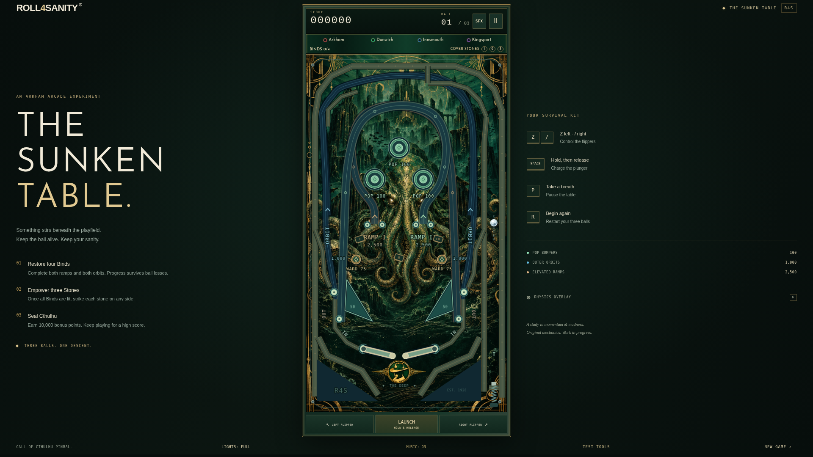

# Roll4Sanity Cthulhu Pinball: The Sunken Table

A browser pinball game from [Roll4Sanity](https://www.roll4sanity.com/), where an underwater city, occult machinery and a certain slumbering creature meet an arcade table. The project began as a celebration for Roll4Sanity's 500 YouTube subscribers and has grown through playtesting and iteration.

**[Play the Four Binds and Three Seals playtest](https://cosmicoutpost.github.io/roll4sanity-cthulhu-pinball/playtest-candidate/)**

The game is a work in progress. It runs in your browser without an account or download. Desktop keyboards and on-screen touch controls are supported.



[View a mobile screenshot](docs/previews/final-rail-design/mobile.png)

## How to play

You have three balls to bind Cthulhu and build a high score:

1. Complete all four different magical shots: the left and right ramps and the left and right orbits. Each completes one Bind. Your progress carries over when you lose a ball.
2. Once all four Binds are lit, strike each of the three Cover Stones. Any side of a stone counts when the ball genuinely collides with it.
3. Activate all three stones to bind Cthulhu and earn a 10,000-point bonus. Keep playing until the last ball drains.

Repeat shots and stone hits still score. The game has one ball in play at a time; there is no multiball. The current game does not store a persistent high-score table.

The Bind indicators are named for their shots: Arkham is the right ramp, Dunwich the left ramp, Innsmouth the left orbit and Kingsport the right orbit.

| Control | Action |
| --- | --- |
| Z | Left flipper |
| / | Right flipper |
| Space | Hold to charge the plunger, then release to launch |
| P | Pause or resume |
| R | Start a new three-ball game |
| D | Toggle the collision and velocity overlay |

On a phone or tablet, use the flipper buttons and hold and release **LAUNCH**. A weak launch can return to the plunger for another attempt. **SFX** mutes game audio and music; **MUSIC** controls the soundtrack separately. **LIGHTS: CALM** reduces motion and lighting effects. Sound starts after a player interaction, as required by browsers.

The candidate includes optional **TEST TOOLS** in the footer for examining the ritual. Test Mode starts a separate fresh game with the four Binds already active; the contact and hit counters can help during playtesting.

## Which version am I playing?

GitHub Pages currently hosts separate builds:

- [`/playtest-candidate/`](https://cosmicoutpost.github.io/roll4sanity-cthulhu-pinball/playtest-candidate/) is the current Four Binds and Three Seals playtest described above.
- [`/playtest/`](https://cosmicoutpost.github.io/roll4sanity-cthulhu-pinball/playtest/) is the earlier ritual prototype.
- [`/`](https://cosmicoutpost.github.io/roll4sanity-cthulhu-pinball/) is the earlier live game, without the newer ritual objective.

The candidate is a playtest, not a promise that every shot is equally easy to aim. Human feedback remains important for judging balance and feel.

## How it works

The table uses [Phaser 3](https://phaser.io/) for its browser scene and Canvas rendering, and [Matter.js](https://brm.io/matter-js/) for the ball and collisions. The playfield is a 540 × 960 portrait design. Physics runs on a fixed timestep, independently of how often the screen redraws. Ramps and orbits use guided paths for their elevated or looping journeys.

[Vite](https://vite.dev/) builds the game into static files. Artwork, fonts and code are served locally; sounds and music are generated in the browser with Web Audio. No database, account system or external runtime service is required.

The story behind the design, repairs and testing is in [HOW_IT_WAS_MADE.md](HOW_IT_WAS_MADE.md).

## Develop locally

Use Node.js **22.12 or later**, or Node **20.19 or later in the Node 20 release line**. The project has also been checked with Node 24.

```sh
npm ci
npm run dev
```

Open the address Vite prints, normally `http://localhost:5173/`, and click the page to give it keyboard focus. If the npm cache is not writable in a cloud workspace, use `npm ci --cache /tmp/roll4sanity-npm-cache`.

The normal development server runs the checked-out source. The separately published candidate is assembled from the pinned ritual prototype with candidate-specific changes by `.github/pages/build-candidate.py`; it is not identical to simply running `npm run dev` on this branch. The Pages workflow describes how the three versions are assembled and checked.

## Build and test

```sh
npm test               # Node tests for game state and Matter physics
npm run build          # Build static files into dist/
npm run preview        # Serve the production build locally
npm run test:browser   # Build, then run Playwright browser tests
npm run check          # Node tests and production build
```

The browser tests use Chromium. In CI, Playwright uses its installed browser; locally the configuration defaults to `/usr/bin/chromium`. Install a compatible Chromium browser and set `CHROMIUM_PATH` if it lives elsewhere, or use `npx playwright install chromium` and point `CHROMIUM_PATH` to the installed executable.

Tests cover individual mechanisms and complete three-ball browser sessions. Some focused physics fixtures place a ball near a mechanism to reproduce a particular contact; those fixtures do not prove that a person can make the same shot in ordinary play. Browser tests and human playtesting complement one another.

For static hosting, upload the **contents of `dist/`**, including its `assets/` directory. Vite uses relative paths so a build can run in a subdirectory. Serve it over HTTP rather than opening `index.html` directly. A WordPress site can host the files in a subdirectory and embed the game in an iframe with sufficient space for the table and controls.

The GitHub Pages workflow builds the live game and both playtest paths as one site and checks the existing releases before publishing. Review `.github/workflows/pages.yml` before changing deployment. A commit marked `[skip pages]` skips the deployment job.

## Project files

- `src/game/table.js`: playfield dimensions, rails and guided-shot definitions.
- `src/game/physics.js`: Matter simulation, ball lifecycle, flippers, launcher and collisions.
- `src/game/state.js` and `src/game/binding-ritual.js`: scoring, turns and ritual progress.
- `src/game/render.js`, `src/game/art-layers.js` and `src/game/lights.js`: presentation and lighting.
- `src/game/audio.js`, `src/game/ritual-audio.js` and `src/game/music.js`: procedural sound and music.
- `.github/pages/`: candidate-specific presentation and assembly.
- `tests/`: mechanism, state and browser checks, plus investigation reports.

The locally bundled Josefin Sans font is distributed under the SIL Open Font License 1.1. Its notice is in [`public/fonts/JosefinSans-OFL.txt`](public/fonts/JosefinSans-OFL.txt).
